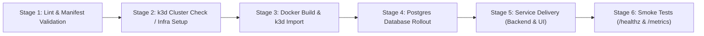

# Jenkins CI/CD Setup & Local Testing Guide

This project supports **both** GitHub Actions (`.github/workflows/ci-cd.yaml`) and Jenkins (`Jenkinsfile`), allowing both CI/CD engines to co-exist cleanly.

---

## 1. Pipeline Architecture

Both GitHub Actions and Jenkins execute the same 6-stage lifecycle:



### Intelligent k3d Reuse Condition
In Stage 2, `scripts/setup-k3d.sh` and `scripts/setup-k3d.ps1` include a smart condition:
- **If an active k3d instance is already running locally** (e.g. `harness-lab` or `ai-agent-cluster` with `1/1` servers running), the pipeline **skips fresh installation** and reuses the active cluster.
- **If the cluster exists but is stopped** (`0/1` servers), the pipeline starts it without reinstalling.
- **If no cluster is running**, the pipeline provisions a fresh k3d cluster declaratively using `ai-agent/k8s/k3d-config.yaml`.
- The active cluster name is automatically written to `.k3d-active-cluster` and used for subsequent `k3d image import` commands.

---

## 2. Testing the Pipeline Locally (Quickest)

You can run and test all 6 pipeline stages locally on your machine before triggering remote CI/CD.

### On Windows (PowerShell):
```powershell
.\scripts\test-pipeline-local.ps1
```

### On Linux / WSL / macOS (Bash):
```bash
chmod +x ./scripts/test-pipeline-local.sh
./scripts/test-pipeline-local.sh
```

This runs:
1. Python syntax compilation and Kustomize manifest dry-run.
2. Checks for running k3d cluster (skips reinstall if active).
3. Builds container images and imports them into k3d.
4. Deploys PostgreSQL `StatefulSet` + PVC + Secrets and waits for rollout.
5. Deploys Backend and Frontend workloads via Kustomize.
6. Executes smoke tests verifying `/healthz` and Prometheus `/metrics`.

---

## 3. Running Containerized Jenkins Locally

A pre-configured Jenkins runner is provided under `jenkins/`:

### Prerequisites:
- Docker Desktop running with WSL2 backend.

### Launching Local Jenkins:
```bash
docker compose -f jenkins/docker-compose.yaml up -d --build
```

### What This Does:
1. Builds a custom Jenkins image with `docker-cli`, `kubectl`, `k3d`, and `python3`.
2. Automatically pre-installs required pipeline plugins (`workflow-aggregator`, `git`, `ansicolor`, `job-dsl`, `configuration-as-code`).
3. Disables the initial setup wizard and mounts your host Docker daemon socket.
4. Pre-seeds a job named `kubernetes-ai-agent-ci-cd` configured with `Jenkinsfile`.

### Accessing Jenkins:
- Open your browser to **http://localhost:8080**
- Login credentials:
  - **Username**: `admin`
  - **Password**: `admin`
- Select **kubernetes-ai-agent-ci-cd** → Click **Build Now**.

---

## 4. Configuring Jenkins Credentials for Production
In Jenkins (`Manage Jenkins -> Credentials`), you can optionally add:
- **ID**: `MESH_API_KEY` (Secret text): Your LLM API key for live inference tests during build.
  *(If omitted, the pipeline automatically falls back to mock credentials for health checking).*
